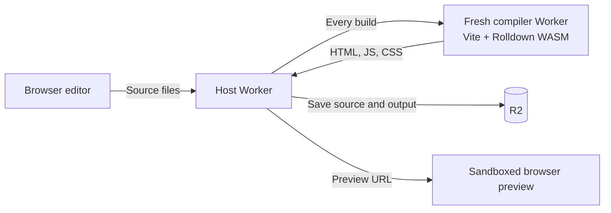
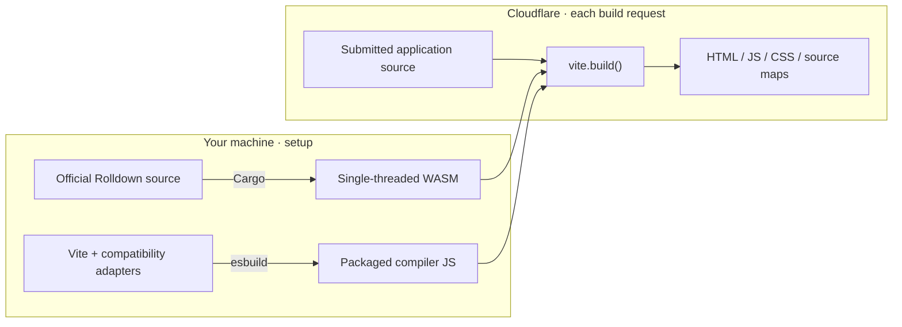

# Vite in Workers

Edit a React app. Run `vite.build()` inside a Cloudflare Dynamic Worker. Open the result.



**Experimental:** Vite 8.3.5 on a custom Worker port, with Rolldown 1.2.15 compiled
from official upstream source.

## Try it

Requires **Node 24.22.0**, Git, and [rustup](https://rustup.rs/).

```sh
git clone https://github.com/irvinebroque/vite-in-workers.git
cd vite-in-workers
npm ci
npm ci --prefix host
npm run build:rolldown                  # Compile the WASM toolchain once
cp -n host/.dev.vars.example host/.dev.vars
npm run dev
```

Open [localhost:8787](http://localhost:8787).

**Build & preview → click the app's task button → edit `title.ts` → build again.**

## Send source, get a build

With the local server running:

```sh
curl http://localhost:8787/build \
  -H 'Authorization: Bearer local-demo' \
  -H 'Content-Type: application/json' \
  --data-binary @- <<'JSON'
{
  "entry": "main.ts",
  "files": {
    "main.ts": "const answer: number = 42; export default answer;"
  }
}
JSON
```

Selected response fields—each output also includes its generated `code`:

```json
{
  "viteVersion": "8.3.5",
  "rolldownVersion": "1.2.15",
  "runtime": "Cloudflare-Workers",
  "output": [
    { "filename": "app.js" },
    { "filename": "app.js.map" }
  ]
}
```

For a React app with HTML, CSS, and a preview URL, use
`--data @prepared/example.json` instead of the inline JSON.

## Where compilation happens



The compiler Worker has an in-memory filesystem, no storage bindings, and no
outbound network. The host saves completed builds in R2.

| Included | Outside this demo |
| --- | --- |
| React/TSX, HTML, CSS, JSON, SVG, lazy imports | HMR, SSR frameworks, Sass, Tailwind |
| Fixed React/React DOM/clsx packages | Arbitrary npm installs or user plugins |
| Source locations for build errors | TypeScript type checking |

## Two smaller demos

```sh
npm run demo          # Two JS modules → a module exporting 42
npm run demo:backend  # Build a backend → execute it in a separate Worker
```

The backend demo returns:

```json
{ "message": "Hello from a separate application Worker" }
```

## Test

```sh
npx playwright install chromium
npm run test:all       # Local Worker integration + Chromium
```

Worker source is TypeScript. `npm run typecheck` checks it against bindings
generated from the `cf` config; `test:all` includes this check.

## Deploy

Choose your Worker and bucket names in [host/cloudflare.config.ts](host/cloudflare.config.ts).

```sh
npm run token         # Creates private work/hosted-secrets.json
npm run prepare:runtime
cd host
npx cf auth login
npx cf deploy --secrets-file ../work/hosted-secrets.json
```

Use the generated token in the hosted editor. Preview URLs and source maps are public.

## Follow the code

| Start here | What it does |
| --- | --- |
| [src/host.ts](src/host.ts) | Authenticate → create compiler → save revision |
| [src/build.ts](src/build.ts) | Write source to memory → call Vite → return files |
| [compat/rolldown.ts](compat/rolldown.ts) | Load WASM and drive its async runtime |
| [toolchain/](toolchain/README.md) | Build Rolldown from pinned upstream source |

[MIT license](LICENSE)
