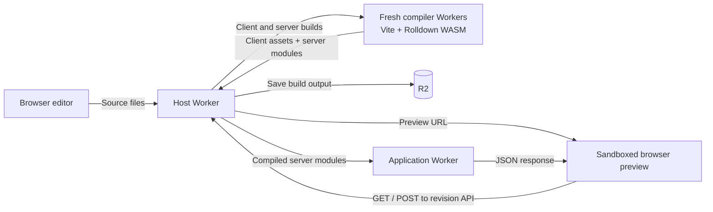
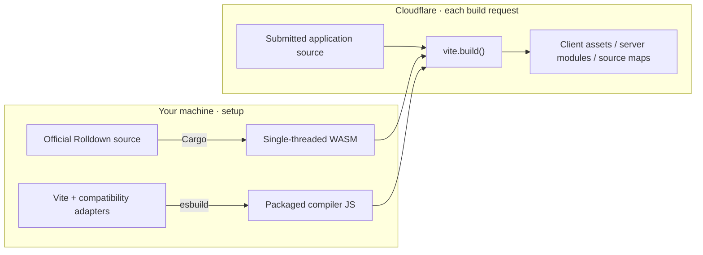

# Vite in Workers

Edit a React app and its TypeScript server. Compile both with `vite.build()` inside
Cloudflare Dynamic Workers, then run the client in the browser and the server in
a separate Dynamic Worker.



**Experimental:** Vite 8.3.5 on a custom Worker port, with Rolldown 1.2.15 compiled
from official upstream source.

## Try it

Requires **Node 24.22.0**, Git, and [rustup](https://rustup.rs/).

```sh
git clone https://github.com/irvinebroque/vite-in-workers.git
cd vite-in-workers
npm ci
npm run build:rolldown                  # Compile the WASM toolchain once
cp -n .dev.vars.example .dev.vars
npm run dev
```

Open [localhost:8787](http://localhost:8787).

**Build & preview → click the task button → edit the message in `server.ts` → build again.**

The task data and button responses come from your compiled server. The preview
shows its response and runtime. Editing `title.ts` changes a module shared by
both client and server; editing `server.ts` changes the running API.

## Send source, get a build

With the local server running:

```sh
curl http://localhost:8787/build \
  -H 'Authorization: Bearer local-demo' \
  -H 'Content-Type: application/json' \
  --data-binary @- <<'JSON'
{
  "entry": "main.ts",
  "files": {
    "main.ts": "const answer: number = 42; export default answer;"
  }
}
JSON
```

Selected response fields—each output also includes its generated `code`:

```json
{
  "viteVersion": "8.3.5",
  "rolldownVersion": "1.2.15",
  "runtime": "Cloudflare-Workers",
  "output": [
    { "filename": "app.js" },
    { "filename": "app.js.map" }
  ]
}
```

For the full-stack React example, use
`--data @prepared/example.json` instead of the inline JSON.
The optional `serverEntry` field names its server source file. The response
includes client `output`, `server.output`, and a revision-specific `serverUrl`.

## Where compilation happens



The compiler Worker has an in-memory filesystem, no storage bindings, and no
outbound network. It uses Workers' native `node:fs`. The host saves completed
build output in R2; editable drafts stay in browser localStorage. Source maps
for client assets include source text and are public with the preview. Server
modules and server source maps are stored separately from those public assets.

The server uses Vite's server build (`ssr.target: 'webworker'`) with dependencies
bundled. Each API request loads those modules in a fresh Dynamic Worker with only
a `REVISION` binding, no outbound network, and a one-second CPU budget. The host
strips cookies and authorization before forwarding a request. The browser
sandbox can call only `/preview/<revision>/api/`; it cannot access the editor's
DOM/storage or arbitrary network destinations.

Client and server builds must both succeed before the revision is saved. A syntax
error in either keeps the previous preview. Server execution errors appear in
the app. The demo's task state lives in the browser and is sent to the server on
each click; it is not a persistent server-side database. Preview APIs are public
to anyone with the revision URL, like the preview itself.

| Included | Outside this demo |
| --- | --- |
| React/TSX, HTML, CSS, JSON, SVG, lazy imports | HMR, SSR frameworks, Sass, Tailwind |
| Compiled TypeScript server handlers and GET/POST APIs | Persistent application state, arbitrary server bindings |
| Fixed browser React/React DOM/clsx packages | React DOM server/static entrypoints, arbitrary npm installs or user plugins |
| Source locations for build errors | TypeScript type checking |

## Two smaller demos

```sh
npm run demo          # Two JS modules → a module exporting 42
npm run demo:backend  # Build the full-stack app → call its compiled server
```

Selected fields from the backend demo's response:

```json
{ "message": "Hello from server.ts", "runtime": "Cloudflare-Workers" }
```

The editor and CLI demo use the same build and preview API. There is no separate
backend deployment or saved-source-restoration endpoint. Delete a saved build with an authenticated
`DELETE /builds/<id>` request; already cached public assets can remain available.

## Test

```sh
npx playwright install chromium
npm run test:all       # Local Worker integration + Chromium
```

Worker source is TypeScript. `npm run typecheck` checks it against bindings
generated from the `cf` config; `test:all` includes this check.

Integration tests and demos start `cf dev`, using the same configuration as
development. Integration tests use temporary R2 state and restart the server to
check persistence of both builds. Browser tests cover client/server edits,
real API requests, execution failures, preview isolation, and assets.
Tests and demos use `local-demo` by default; set `BUILD_TOKEN` if you change the
token in `.dev.vars`. Browser tests use port 8790 (`TEST_PORT` overrides it).
Set `BUILD_URL` and `BUILD_TOKEN` to test an existing deployment instead.

Tooling is pinned to `cf` **1.0.0-beta.25**, Cloudflare Vite plugin
**2.0.0-beta.v.7**, and their shared Miniflare **5.20261023.2-beta**, the current
releases checked on 2026-10-28. `cloudflare.config.ts` defines the Workers;
`vite.config.ts` connects the official plugin and configures the local server.

## Deploy

Choose your Worker and bucket names in [cloudflare.config.ts](cloudflare.config.ts).

```sh
npm run token         # Creates private work/hosted-secrets.json
npm run prepare:runtime
npx cf auth login
npx cf deploy --secrets-file work/hosted-secrets.json
```

Use the generated token in the hosted editor. Preview URLs and source maps are public.
`npm run build` packages and validates deployment output without uploading it.

## Follow the code

| Start here | What it does |
| --- | --- |
| [src/host.ts](src/host.ts) | Authenticate → create compiler → save revision |
| [src/build.ts](src/build.ts) | Write source to memory → call Vite → return files |
| [src/application.ts](src/application.ts) | Run compiled server modules with isolated bindings |
| [examples/react/server.ts](examples/react/server.ts) | Editable server in the full-stack demo |
| [compat/rolldown.ts](compat/rolldown.ts) | Load WASM and drive its async runtime |
| [toolchain/](toolchain/README.md) | Build Rolldown from pinned upstream source |

[MIT license](LICENSE)
