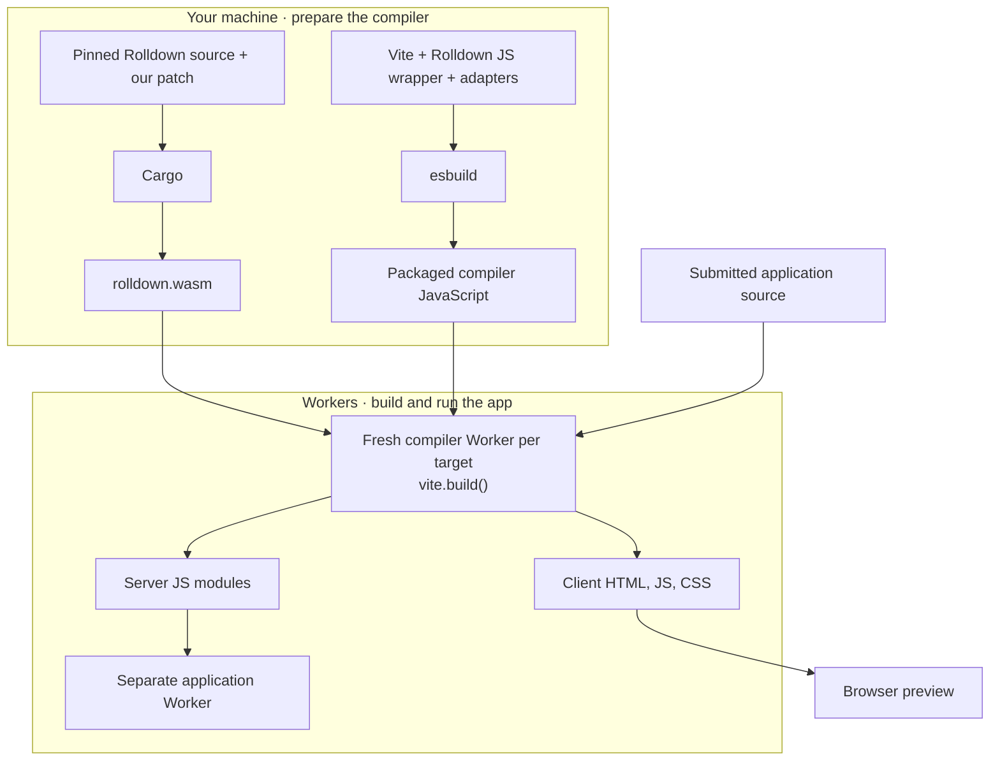
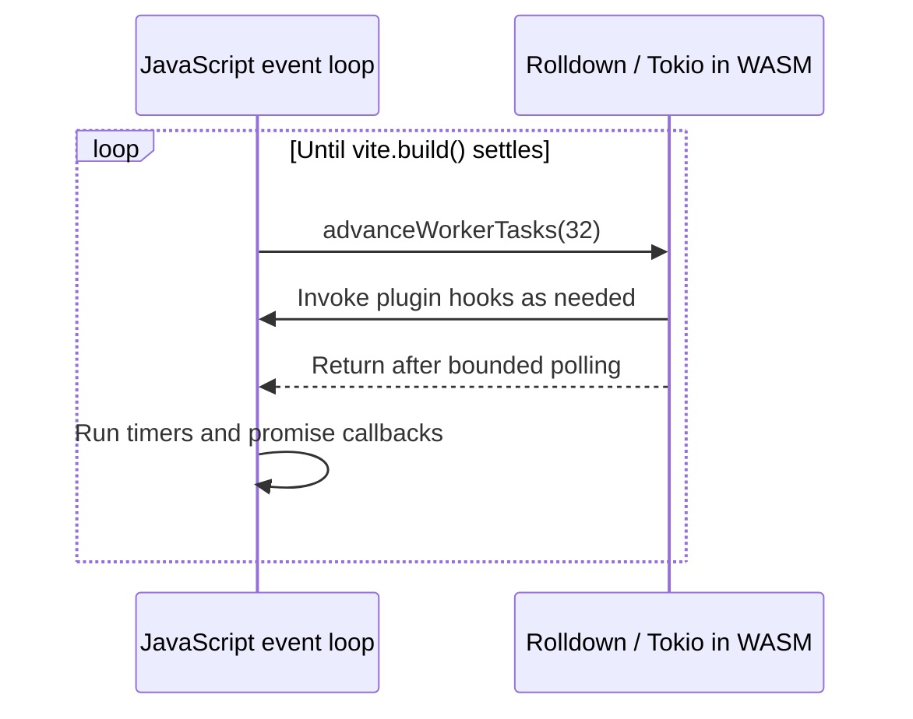

# How Vite runs inside a Worker

Vite's JavaScript API calls Rolldown to bundle code. This toolchain compiles
Rolldown's Rust implementation to WebAssembly and connects it to Vite inside
Cloudflare Workers.

## Prepare the compiler, then build apps



Cargo runs when the toolchain changes. esbuild packages the compiler for
deployment. Each submitted client or server build runs Vite inside a fresh
Worker; the host saves the results and serves the preview.

The compiler's call chain is:

```text
vite.build()
  → official @rolldown/browser JavaScript API
    → emnapi: bridge between JavaScript and Rust's N-API bindings
      → our compiled Rolldown WASM
```

The wrapper and Rust source use the same pinned Rolldown version. The wrapper's
bundled WASM is replaced by the artifact built here.

## Let Rust and JavaScript take turns

Rolldown's Rust tasks can call asynchronous JavaScript plugins. Both must make
progress on the same thread. Blocking Rust until a plugin finishes would prevent
JavaScript from completing that plugin.

[worker-runtime.rs](worker-runtime.rs) supplies a Tokio executor that advances
in bounded steps. [src/compiler/rolldown.ts](../src/compiler/rolldown.ts) drives it:



The core loop in `withRuntime()` is:

```ts
while (!done) {
  binding.advanceWorkerTasks(32);
  await new Promise(resolve => setTimeout(resolve, 0));
}
```

The build promise sets `done` when it resolves or rejects. Each compiler Worker
owns its WASM instance and memory for one build.

## Adapt the runtime and filesystem

[rolldown.patch](rolldown.patch) makes two changes to upstream Rust:

| Change | Why |
| --- | --- |
| Register our N-API async runtime | Let JavaScript drive Rust tasks without spawning threads. |
| Use synchronous asset reads on WASM | Read the in-memory filesystem without Tokio's blocking thread pool. |

The filesystem bridge connects Rust and Vite to the same files:

```text
Vite JavaScript ── node:fs ──────────────┐
                                       ├─ Worker filesystem: /tmp/app/
Rolldown WASM ── WASI ── node:fs ────────┘
```

[src/compiler/runtime.ts](../src/compiler/runtime.ts) writes the fixed dependencies and
submitted source into that filesystem. [scripts/prepare-compiler.js](../scripts/prepare-compiler.js)
packages the compiler using [vite-adapter.js](../scripts/vite-adapter.js) to adapt
Vite's module paths and extract its lexer WASM for loading in Workers.

This is an experimental build-only port. Watch mode and thread-dependent paths
are outside its scope. N-API, Tokio, emnapi, and WASI dependencies are unpatched.

## Build and check it

From the repository root, with Node 24.22.0, Git, rustup, and several GB of free space:

```sh
npm ci
npm run build:rolldown    # Install pinned Rust, patch upstream, compile WASM
npm run check:toolchain  # Verify inputs, binary hashes, memory, and imports
npm run test:all         # Exercise compilation and the browser demo
```

The build uses the release commit, Rust version, and WASM target in
[upstream.json](upstream.json), plus upstream's locked Cargo dependencies.

| Generated file | Purpose |
| --- | --- |
| `toolchain/rolldown.wasm` | Compiler binary loaded into Workers |
| `toolchain/build.json` | Recorded build inputs and hashes |
| `reports/rolldown-build.json` | Verification results, memory limits, and imports |

All three are ignored by Git. Packaging runs the checker automatically and
rejects stale artifacts, shared memory, and unexpected thread imports.

To upgrade, update the pins and matching JS packages, review the Rust patch and
Vite adapters, then rebuild and rerun the tests. See the [main README](../README.md)
for the demo and deployment through `cf` and `cloudflare.config.ts`.
